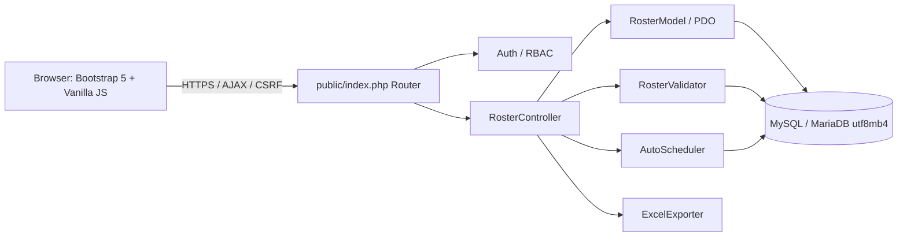
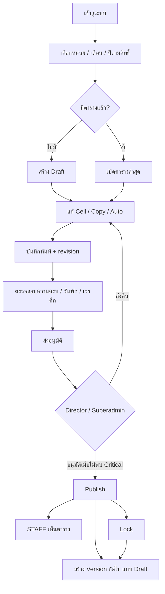
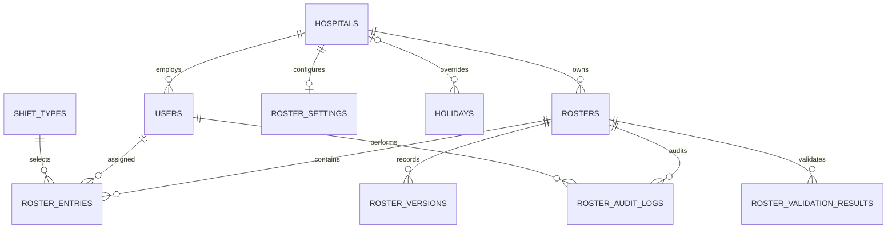

# V4 Update — Workflow Readiness

> ระบบต่อยอดจาก V3 โดยไม่เปลี่ยนโครงสร้างฐานข้อมูล ดู `UPGRADE_V4.md` สำหรับการติดตั้ง และรัน `tests/workflow_v4_test.php` เพื่อทดสอบกฎโดยไม่เชื่อม MySQL

# Sisaket PAO Roster Management — PHP 8 / MySQL MVC

ระบบจัดการเวรและตารางปฏิบัติงาน **สำหรับ รพ.สต. ในสังกัด อบจ.ศรีสะเกษ** เฉพาะโมดูลจัดเวร ไม่มีระบบวันลา, HR, เงินเดือน, ข้อมูล 43 แฟ้ม หรือระบบเอกสาร ใช้งานผ่าน PHP 8+, PDO MySQL, Bootstrap 5, JavaScript และ CSS แบบ Mobile First พร้อมสิทธิ์หลายหน่วยบริการ

> **สถานะการส่งมอบ:** Source code โครงสร้างเต็มและตรวจสอบ PHP/JS syntax แล้วในสภาพแวดล้อมสร้างไฟล์ แต่ **ยังไม่ได้ทดสอบ Integration/E2E กับ XAMPP และ MySQL/MariaDB จริง** จึงต้องผ่าน `bin/diagnose.php` และ Acceptance Test ก่อนเปิดใช้จริง โดยเฉพาะเวรอัตโนมัติและการเผยแพร่ตาราง

## 1) Requirement Analysis

- หน่วยบริการหลาย รพ.สต.; ผู้ใช้ผูก `hospital_id` เสมอ และกำหนด Role ตั้งแต่ SUPERADMIN ถึง HR
- ดู / จัดตารางแบบ Matrix รายคน × 28–31 วัน, หัวและคอลัมน์ Sticky, Calendar, Fairness, Day View บนมือถือ
- เวร MORNING (08–16), AFTERNOON (16–00), NIGHT (00–08), OFF, LEAVE; เพิ่มประเภทเวรได้จาก DB
- ผู้มีสิทธิ์จัดเวรจะไม่เห็น **SUPERADMIN / ADMIN / HR** ใน Staff Pool และ API จะปฏิเสธการจัดเวรให้สาม Role นี้
- AJAX บันทึก Cell, Bulk transaction, Optimistic locking, Copy month, Auto schedule, Validation, Audit
- Workflow `DRAFT → PENDING_APPROVAL → APPROVED → PUBLISHED → LOCKED` และบันทึกสำเนาเวอร์ชันก่อนแก้ Published
- Export `.xlsx` (ใช้ `ZipArchive`), Print และ PDF ผ่าน Print → Save as PDF

## 2) Architecture



`public/index.php?c=roster&a=index` คือหน้าหลัก; API ใช้ `?c=roster&a=<action>` ไม่มีการเปิดโฟลเดอร์ `app/` และ `database/` ผ่านเว็บ รูปแบบ MVC แยก Controller, Model, Service, View

## 3) User Flow



## 4) Database ERD



## 5) SQL CREATE TABLE

ไฟล์ **`database/schema.sql`** มีตาราง 10 ตารางพร้อม FK / Unique / Index / InnoDB รวมถึง `UNIQUE(roster_id, user_id, work_date)` ป้องกันบุคลากร 1 คนมีมากกว่า 1 เวรต่อวัน และ `UNIQUE(hospital_id, year, month, version)` ป้องกันการสร้างเวอร์ชันซ้ำ. ไฟล์ **`database/seed.sql`** เพิ่มหน่วยบริการตัวอย่าง 1 แห่ง, Shift 5 ประเภท และ Default Roster Settings 1 ชุด. ให้ปรับรหัสสถานพยาบาล ชื่อจริง และรายชื่อผู้ใช้ก่อนใช้งานจริง

## 6) Folder Structure / 20) Complete File List

```text
sisaket-roster/
├── config.example.php          Configuration template (copy to config.php)
├── .htaccess                   Prevent directory listing / protect sensitive files
├── index.php                   Redirect root URL to public/index.php
├── .gitignore                  Ignore secrets
├── README.md                   Full instructions and notes
├── app/
│   ├── .htaccess
│   ├── Core/
│   │   ├── Auth.php            Session RBAC / Hospital scope
│   │   ├── Csrf.php            CSRF protection
│   │   ├── Database.php        PDO connection
│   │   └── bootstrap.php       Autoload / shared helpers
│   ├── Models/
│   │   └── RosterModel.php     SQL queries / row version locking / audit
│   ├── Controllers/
│   │   ├── AuthController.php  Sign in / sign out
│   │   └── RosterController.php All roster actions
│   ├── Services/
│   │   ├── AutoScheduler.php   Deterministic fairness heuristic
│   │   ├── RosterValidator.php Business rule validations
│   │   └── ExcelExporter.php   Standalone xlsx / csv fallback
│   └── Views/
│       ├── auth/login.php      Login screen
│       └── roster/
│           ├── index.php      Responsive roster dashboard
│           └── print.php      Government-style A3 printable roster
├── public/
│   ├── .htaccess
│   ├── index.php               MVC front controller / action whitelist
│   ├── css/roster.css          Theme / responsive / fullscreen
│   └── js/roster.js            Grid / Calendar / mobile / AJAX
├── database/
│   ├── .htaccess
│   ├── schema.sql              Create tables
│   └── seed.sql                Defaults / example facility
├── bin/
│   ├── create_user.php        CLI account provisioning
│   └── diagnose.php           System / DB checks
├── docs/
│   └── design-and-security.md Detailed design and risk notes
└── tests/
    ├── static_test.php        DB-free integrity test
    └── acceptance.md          45 manual test cases
```

## 7–8) Models & Controllers

- `RosterModel` มี `hospitals()`, `staff()`, `rosterStaff()`, `settings()`, `latest()`, `entries()`, `create()`, `saveCells()`, `newRevision()`, `auditList()`. การโหลดเดือนดึงชุดข้อมูล `entries` ครั้งเดียว ไม่ query ต่อ cell. ขณะบันทึก ใช้ Transaction และล็อก `rosters` row (`SELECT ... FOR UPDATE`), เช็ก `lock_version` ก่อนเปลี่ยนข้อมูล
- `RosterController` แยกความสามารถของสถานะกับ Role และมี `settings_save` ให้ SUPERADMIN/ADMIN กำหนดขั้นต่ำและเพดานเวรของแต่ละหน่วยบริการ; ตรวจ **session + DB** ทุกครั้ง; ไม่มีการเชื่อถือ role/hospital_id ที่ส่งมาจาก Client โดยไม่มีการตรวจสอบ
- `AuthController` มี Login/Logout, `password_verify`, `session_regenerate_id`, lockout แบบ session ชั่วคราว; บัญชีสร้างผ่าน CLI เท่านั้น (ไม่มีระบบ HR เพิ่มเข้ามา)

## 9–11) Views, JS, CSS

- `app/Views/roster/index.php`: Toolbar, Summary, Sticky table, Staff Pool, Calendar, Fairness, Modal
- `public/js/roster.js`: Shift Picker, Copy/Paste, Drag & Drop, Context Menu, Mobile Day View, AJAX Save, Version Checking, Validation UI, Fullscreen API
- `public/css/roster.css`: สี Healthcare Government SaaS, Kanit สำหรับหัวข้อ, Sarabun ข้อความ, focus indicators, fullscreen, Drawer ตามพื้นที่จริง (ResizeObserver)
- มือถือไม่แสดงกริด 31 วันในพื้นที่บีบอัด แต่ใช้ Day View แทน

## 12) AJAX API

| HTTP | Path (ทั้งหมดนำหน้าด้วย `index.php?c=roster&a=`) | ข้อมูลสำคัญ / สิทธิ์ |
|---|---|---|
| GET | `index` | หน้า Roster (ทุก Role ผ่าน Login) |
| GET | `data` | `hospital_id, year, month`; STAFF เห็นเฉพาะ Published/Locked |
| POST | `create` | `hospital_id, year, month` / SCHEDULER ADMIN SUPERADMIN |
| POST | `save_shift` | `roster_id, user_id, date, shift_type_id, note, expected_revision` / Editor ใน DRAFT |
| POST | `bulk_save` | `roster_id, expected_revision, changes[]` / Editor, Transaction |
| GET | `validate` | `roster_id` / ทุก Role ตาม Scope |
| POST | `auto_preview` / `auto_apply` | `roster_id, expected_revision` / Editor ใน DRAFT |
| POST | `copy_preview` / `copy_apply` | `roster_id, expected_revision` / Editor ใน DRAFT |
| POST | `submit` | DRAFT → PENDING / Editor |
| POST | `approve` | PENDING → APPROVED / DIRECTOR SUPERADMIN |
| POST | `reject` | PENDING → DRAFT / DIRECTOR SUPERADMIN; มี reason |
| POST | `publish` | APPROVED → PUBLISHED / DIRECTOR ADMIN SUPERADMIN |
| POST | `lock` | PUBLISHED → LOCKED / DIRECTOR ADMIN SUPERADMIN |
| POST | `new_revision` | PUBLISHED/LOCKED → new DRAFT / Editor; มี reason |
| GET | `export_print` / `export_excel` | `roster_id` / ผ่านสิทธิ์ Scope |
| GET | `audit` | `hospital_id` / SUPERADMIN เท่านั้น |
| POST | `settings_save` | `hospital_id,min_morning,min_afternoon,min_night,max_consecutive_work_days,max_night_shifts` / SUPERADMIN ADMIN |

ทุก POST ต้องส่ง Header `X-CSRF-Token`. ตัวอย่าง AJAX เซฟ Cell:

```json
{
  "roster_id": 1,
  "user_id": 8,
  "date": "2026-10-12",
  "shift_type_id": 1,
  "note": "",
  "expected_revision": 0
}
```

Response: `{ "success": true, "message": "บันทึกเวรแล้ว", "saved": 1, "revision": 1, "validation": {"CRITICAL":0,"WARNING":0,"INFO":0} }` (นับตัวอย่างเท่านั้น จำนวนจริงขึ้นกับข้อมูลเดือน)

## 13) Validation Engine

`RosterValidator::run()` ตรวจเวรเช้า/บ่าย/ดึกแต่ละวันต่ำกว่าเกณฑ์ (Critical), บุคลากรไม่ผ่านเงื่อนไข (Critical), เวรดึก→เช้าวันถัดไป (Critical), เวรต่อเนื่อง, จำนวนเวรดึก, ไม่พบวันพัก (Warning) รวมถึง Shift ที่ปิดใช้งาน. เกณฑ์ปรับที่ `roster_settings`. ผล Validation บันทึกเมื่อเปลี่ยนสถานะไว้ใน `roster_validation_results`. Publish/Approve ต้องไม่มี **Critical**. ควรปรับเกณฑ์ขั้นต่ำให้เหมาะกับจำนวนบุคลากรจริงก่อนใช้งาน

## 14) Auto Scheduling Algorithm

`AutoScheduler::plan()` จัดเวรเชิง Heuristic ตามลำดับ Night → Morning → Afternoon วันต่อวัน โดยไม่เขียนทับ Cell ที่มีอยู่ และพยายามรักษา Minimum Coverage, Max Night, Max Consecutive, หลีกเลี่ยง Night→Morning, กระจายเวรตามจำนวนรวม/Weekend/Holiday และประเภทบุคลากรในแต่ละกะ. เติม OFF ในช่องว่างหลังจัดเวร. หากบุคลากรไม่พอ ระบบส่ง `unfilled` ให้เห็น ไม่แอบอ้างว่าครบเกณฑ์. **นี่ไม่ใช่ตัวแก้ Optimization แบบ Global Constraint** จึงควร Preview / Validate / ตรวจทานก่อน Approve

## 15) Fullscreen Focus Mode

ใช้ `requestFullscreen()` และ `exitFullscreen()` จริง; Focus Toolbar ติดด้านบน พร้อมปุ่มรายชื่อ, ตรวจสอบ, บันทึก, ออกเต็มจอ; Esc ย้อนกลับสู่ปกติ. Browser เล็กลงด้วย DevTools จะเปลี่ยน Staff Panel เป็น Drawer โดย `ResizeObserver` และความกว้างจริงของ Workspace

## 16) Mobile UI

ที่ความกว้าง ≤780px ใช้ **Day View** แยก Morning, Afternoon, Night, OFF และ Leave พร้อมปุ่มวันก่อน/วันนี้/วันถัดไป. Staff Panel เป็น Drawer เมื่อ Workspace เล็กกว่า 1180px. มุมมอง Calendar และ Fairness แสดงแบบ responsive

## 17) Security Review

ดูเอกสาร **`docs/design-and-security.md`** สำหรับ RBAC matrix, เทคโนโลยี, PDPA, Threats, การบริหาร Secret และข้อจำกัดก่อน Production. เริ่มต้นระบบนี้ไม่อนุญาตให้จัดเวรจากบัญชี Role SUPERADMIN, ADMIN, HR แม้บุคคลนั้นจะมีสิทธิ์เข้าดูข้อมูล. เหตุการณ์แก้ไขเก็บใน Audit Logs พร้อม IP แบบ keyed hash และไม่บันทึก raw IP

## Troubleshooting: 403 Forbidden ที่ `http://localhost/sisaket-roster/`

ใน ZIP รุ่นเดิม root `.htaccess` ใช้ `Require all denied` ซึ่งทำให้เข้าไม่ได้ทั้งหน้าแรกและหน้า `public`. รุ่นแก้ไขนี้มีไฟล์ `index.php` ที่ root เพื่อ Redirect ไป `public/index.php` และเปลี่ยน `.htaccess` ให้ป้องกันไฟล์ความลับแทนการบล็อกทั้งโปรเจกต์ โดยยังคงบล็อก `app/`, `database/`, `bin/`, `docs/`, `tests/` ด้วย `.htaccess` ของแต่ละโฟลเดอร์.

หากยังเป็น 403 หลังเปลี่ยนไฟล์ ให้ตรวจว่ามีโฟลเดอร์ซ้อน `sisaket-roster/sisaket-roster`, เคลียร์ `.htaccess` เดิมจริง, เปิด `http://localhost/sisaket-roster/public/index.php?c=auth&a=login` เพื่อลองตรง, และดู `C:\xampp\apache\logs\error.log`.

## 18) Installation Guide — Windows XAMPP

1. ติดตั้ง XAMPP ที่มี **PHP 8.0+**, MySQL/MariaDB, Apache; เปิด Apache และ MySQL ใน XAMPP Control Panel. ตรวจ `php.ini`: ต้องเปิด `pdo_mysql`, `mbstring`, `zip`, `openssl`; สำหรับ Excel `.xlsx` ต้องเปิด ZIP. Restart Apache หลังแก้
2. แตก ZIP ไปที่ `C:\xampp\htdocs\sisaket-roster\` (ภายในต้องมี `public\index.php`)
3. เปิด phpMyAdmin ที่ `http://localhost/phpmyadmin/`; Import `database/schema.sql` ก่อน ตามด้วย `database/seed.sql`. ชื่อ Database คือ `sisaket_roster`
4. แนะนำให้สร้างผู้ใช้ฐานข้อมูลแบบ Least Privilege ด้วย SQL ผ่าน phpMyAdmin (ล็อกอิน root ในเครื่องทดสอบ):

   ```sql
   CREATE USER 'roster_app'@'127.0.0.1' IDENTIFIED BY 'STRONG_RANDOM_DATABASE_PASSWORD';
   GRANT SELECT, INSERT, UPDATE, DELETE ON sisaket_roster.* TO 'roster_app'@'127.0.0.1';
   ```

   หากใช้ `localhost` แทน `127.0.0.1` ใน config ให้ GRANT host ให้ตรงกับการเชื่อมต่อ. สิทธิ์สร้าง Schema ใช้เฉพาะตอนติดตั้ง ไม่ควรให้ App User ถาวร
5. Copy `config.example.php` เป็น `config.php`; ใส่ host/port/db/user/password ให้ตรง; ตั้ง `ip_hash_secret` แบบสุ่มอย่างน้อย 32 ตัวอักษร และกำหนด `cookie_secure=false` สำหรับ `http://localhost` เท่านั้น (ใช้ `true` บน HTTPS)
6. เปิด XAMPP Shell หรือ Command Prompt (ถ้า `php` ไม่อยู่ใน PATH ให้ใช้ `C:\xampp\php\php.exe`):

   ```powershell
   cd C:\xampp\htdocs\sisaket-roster
   php bin\diagnose.php
   php tests\static_test.php
   ```

7. สร้าง SUPERADMIN ผ่าน CLI (คำสั่งนี้เป็นบัญชีของตัวอย่าง รพ.สต. แห่งแรก)

   ```powershell
   $env:ROSTER_NEW_USER_PASSWORD = 'Your_OWN_Strong_Password_2026!'
   php bin\create_user.php SSK-DEMO-001 SUPERADMIN admin@example.local "ผู้ดูแลระบบตารางเวร"
   Remove-Item Env:\ROSTER_NEW_USER_PASSWORD
   ```

   จากนั้นสร้างบัญชี `SCHEDULER`, `DIRECTOR`, `STAFF` ตาม Role โดยใช้คำสั่งเดียวกัน เปลี่ยนค่าพารามิเตอร์. สำหรับหน่วยบริการจริง ให้นำเข้าข้อมูล `hospitals` จากทะเบียนหน่วยงานที่ตรวจสอบแล้ว และ provision แต่ละบัญชีให้มี `hospital_id` ที่ถูกต้อง **อย่านำรหัสผ่านตัวอย่างหรือข้อมูลบุคคลจริงลงใน Source Code**
8. เปิดเว็บ `http://localhost/sisaket-roster/` ซึ่งจะ Redirect ไป `public/index.php?c=auth&a=login` โดยอัตโนมัติ หรือเปิด URL `http://localhost/sisaket-roster/public/index.php?c=auth&a=login` โดยตรง จากนั้นเลือกเดือน สร้าง Draft และจัดเวร
9. ตรวจ `tests/acceptance.md` ให้ครบ โดยเฉพาะกรณีข้อมูลหลาย รพ.สต., วันที่, Role, Transaction, Concurrency และ Export ก่อนให้หน่วยงานใช้งานจริง

**สำคัญสำหรับ Production:** ตั้ง Apache VirtualHost ให้ `DocumentRoot` ชี้ไปที่ `sisaket-roster/public` โดยตรง, ใช้ HTTPS, ปิด Directory Listing, ตั้ง PHP `display_errors=Off`, สำรอง Database เข้ารหัส และอย่าเปิด phpMyAdmin สู่ Internet โดยไม่ป้องกัน. หากติดตั้งใน `htdocs` ตามคู่มือบน localhost โปรเจกต์มี `.htaccess` เพื่อป้องกันการอ่าน `app/` และ `database/` ตรงผ่าน Apache 2.4 แต่ VirtualHost แบบ Public-only ยังคงปลอดภัยกว่า

## 19) Test Cases

ใช้ชุด **`tests/acceptance.md`** จำนวน 46 กรณี ครอบคลุม Role, Scope, Conflict, Coverage, Date, Workflow, View, Export และ Security. ระบบมี `php tests/static_test.php` ตรวจไฟล์และโครงสร้าง Constraint โดยไม่ต้องใช้ DB และ `php bin/diagnose.php` ตรวจความพร้อมเครื่องจริง

## หมายเหตุการใช้งาน

- เวลาของเวรมีผลกับชั่วโมงปฏิบัติงาน; หากหน่วยบริการใช้กะคร่อมวันในความหมายอื่น ต้องปรับเกณฑ์และตรวจอัตรากำลังตามข้อเท็จจริง
- ตาราง `holidays` ต้องนำเข้ารายการวันหยุดจริงแยกตามปี (Seed ไม่มีวันหยุดปี 2569 เพื่อไม่สมมติข้อมูล)
- ตารางที่ Published จะไม่ถูกแก้ทับโดยตรง; ใช้ `สร้าง Version ใหม่` เพื่อให้ STAFF เห็น Version เดิมต่อไป จนรุ่นใหม่ผ่านการอนุมัติและ Publish
- การกดปุ่ม **บันทึก Draft** ยืนยันสถานะการบันทึกอัตโนมัติ ทุกการแก้ไข Cell ใช้ AJAX ทันที ระบบไม่เก็บข้อมูลไม่บันทึกไว้ใน Browser
- โปรเจกต์ตั้งใจเป็น **โมดูล Roster แยกเดี่ยว** ถ้าจะเชื่อมต่อ Roster Pro เดิมควร map ตาราง users/hospitals/roles ที่มีอยู่ก่อน ไม่ควร import schema ทับตาราง Production โดยตรง

---

## การสร้างบัญชีผู้ดูแลระบบอย่างปลอดภัย

ชุด Public นี้ **ไม่รวมสคริปต์สร้างบัญชีด้วยรหัสผ่านเริ่มต้นที่ทราบล่วงหน้า**

1. สำรองฐานข้อมูลและติดตั้งระบบตามคู่มือ โดยสร้าง `config.php` บนเซิร์ฟเวอร์จาก `config.example.php` เท่านั้น (ห้าม Commit)
2. เปิด PHP CLI บนเครื่องผู้ดูแลที่ได้รับอนุญาต ตั้งค่ารหัสผ่านที่แข็งแรงและไม่ซ้ำกับระบบอื่น แล้วสร้างบัญชีผู้ดูแล:

```powershell
cd C:\xampp\htdocs\sisaket-roster
$env:ROSTER_NEW_USER_PASSWORD = Read-Host 'New strong password (12+ characters)'
C:\xampp\php\php.exe bin\create_user.php SSK-DEMO-001 SUPERADMIN admin@example.local "ผู้ดูแลระบบ"
Remove-Item Env:\ROSTER_NEW_USER_PASSWORD
```

> หมายเหตุ: `Read-Host` ในตัวอย่างจะแสดงข้อความรหัสผ่านขณะพิมพ์ในบาง PowerShell; ใช้ช่องทางจัดการ Secrets ที่ปลอดภัยหากเป็นเครื่องที่มีคนอื่นเข้าถึงได้ และอย่าเก็บรหัสผ่านไว้ในไฟล์โค้ดหรือประวัติ Shell. สำหรับ Production ควรเปลี่ยนอีเมล/รหัสหน่วยบริการเป็นของจริงและกำหนดสิทธิ์เฉพาะที่จำเป็น

ไม่เปิดใช้งานบัญชีทดสอบจากสคริปต์เก่า และไม่เผยแพร่ฐานข้อมูลจริงหรือข้อมูลบุคลากรขึ้น GitHub

---

## เพิ่มเติม v2 – จัดการบุคลากรและหน่วยบริการ

มีเมนู **จัดการข้อมูล** ที่แถบบนหลังเข้าสู่ระบบด้วยสิทธิ์ SUPERADMIN หรือ ADMIN

- จัดการรายชื่อผู้ปฏิบัติงาน: เพิ่ม, แก้ไข, ค้นหา, กรองตาม รพ.สต., ปิด/เปิดบัญชี, รีเซ็ตรหัสผ่านสุ่ม, กำหนด Role (ตามสิทธิ์)
- จัดการหน่วยบริการ: ดูรายการ, เพิ่ม, แก้ไขชื่อ/อำเภอ/ตำบล และปิดหน่วยบริการเมื่อไม่มีบัญชีใช้งาน
- ใช้ตาราง `users` และ `hospitals` เดิมโดยไม่เปลี่ยน schema; บันทึก audit ทุกการเปลี่ยนแปลง; ไม่ลบประวัติย้อนหลัง

**ติดตั้งต่อจากเวอร์ชันเดิม:** อ่านไฟล์ `UPGRADE_V2.md` เพื่ออัปเกรดโดยไม่เขียนทับฐานข้อมูลหรือ `config.php`

เรียกตรวจ static และ view rendering เพิ่มเติม:

```bash
php tests/management_static_test.php
php tests/management_render_test.php
```

## V3 — นำเข้าบุคลากร Excel/CSV (12 ตุลาคม 2569)

อัปเกรดต่อจาก V2 โดยไม่เปลี่ยน schema ฐานข้อมูล เปิดเมนู **นำเข้าบุคลากร** หรือ `public/index.php?c=admin&a=staff_import` สำหรับผู้ใช้ SUPERADMIN / ADMIN เลือกหน่วยบริการ, ดาวน์โหลดแม่แบบ, ตรวจ Preview, ยืนยันนำเข้าแบบ Transaction (เฉพาะบัญชีใหม่), ดูรหัสผ่านชั่วคราวครั้งเดียว และดูรายชื่อใน Staff Pool. อ่านรายละเอียดพร้อมขั้นตอนติดตั้งปลอดภัยได้ที่ [`UPGRADE_V3.md`](UPGRADE_V3.md).

แม่แบบ: `public/templates/roster_staff_import_template.xlsx` และ `.csv` ใช้แถวหัวคอลัมน์ `full_name,email,role,position,personnel_type`; รองรับสูงสุด 200 รายชื่อ/ไฟล์ ขนาดไม่เกิน 1MB (PHP `mbstring`, `zip`, `dom` เป็นส่วนขยายที่จำเป็นสำหรับฟีเจอร์นี้). อย่านำเข้า `database/schema.sql` หรือ `database/seed.sql` ใหม่บนระบบที่มีข้อมูลแล้ว.


## V5 — การจัดเวรอัตโนมัติพร้อม Preview และรายงานความเป็นธรรม
ดู [UPGRADE_V5.md](UPGRADE_V5.md) สำหรับติดตั้ง PATCH จาก V4 โดยไม่ลบฐานข้อมูลเดิม และรัน `php tests/autoschedule_v5_test.php` เพื่อตรวจอัลกอริทึมด้วยข้อมูลสมมติ

## V6 — Version History / Comparison / My Schedule

- หน้า Dashboard มีปุ่ม **ประวัติ Version** เฉพาะ SUPERADMIN, ADMIN, SCHEDULER, DIRECTOR
- ประวัติทุก Version พร้อมสถานะ ผู้สร้าง เหตุผล และจำนวนรายการเวร
- เปรียบเทียบคู่ Version เฉพาะหน่วยบริการ/เดือนเดียวกัน แสดงเวรเดิม–เวรใหม่ และแก้หมายเหตุด้วย
- Audit Log แยกตาม Version รวมข้อมูลก่อน/หลัง
- หน้า **เวรของฉัน** สำหรับ STAFF, SCHEDULER, DIRECTOR เป็นแบบอ่านอย่างเดียว มี Print/PDF และไม่เปิด Draft
- ป้องกันการเปิด Version History / Version Comparison / Version Audit ด้วยบัญชี STAFF ฝั่ง Controller
- ป้องกันการสร้าง Version ซ้ำขณะมี Version ใหม่กว่าแล้ว

ดูขั้นตอนอัปเกรดใน `UPGRADE_V6.md` โดย **ไม่ต้องนำเข้า SQL ใหม่**

---

## V7 — Readable Audit Log + Mobile My Schedule

V7 เพิ่ม Audit Log ชื่อเวรก่อน–หลัง พร้อมเก็บ JSON ต้นฉบับและปรับปฏิทินเวรของฉันให้แสดงเป็นการ์ดตามวันบนมือถือ โดยไม่เพิ่มตารางฐานข้อมูลและไม่เปลี่ยน Workflow สิทธิ์เดิม ดู `UPGRADE_V7.md` สำหรับวิธีอัปเกรดจาก V6 และชุดทดสอบ.

## V8 — ป้องกันเวรต่อเนื่องที่พักไม่เพียงพอ

V8 เพิ่ม `min_rest_hours` (เริ่มต้น 11 ชั่วโมง ต่อ รพ.สต.; ตั้งค่าได้ 8–24 ชม.) และ `ShiftRestRules` ที่ใช้ทั้ง Auto Scheduling/Validation, รองรับเวรข้ามเที่ยงคืน. เช่นเวรบ่าย 18 ต.ค. 16:00–00:00 ตามด้วยเวรดึก 19 ต.ค. 00:00–08:00 จะตรวจพบว่าพัก **0 ชั่วโมง** และแสดง `CRITICAL MIN_REST_HOURS`. Auto Scheduling จะไม่เพิ่มคู่เวรที่ผิดกฎ; เวรเก่าไม่ถูกเปลี่ยนอัตโนมัติ. ดู `UPGRADE_V8.md` สำหรับวิธีอัปเกรดฐานข้อมูลก่อนแทนที่ไฟล์และข้อจำกัดเรื่องการตรวจข้ามเดือน.

## V9 — Smart Roster Repair (October 2026)

อัปเกรดจาก V8 ได้โดยไม่แก้ schema เพิ่ม: ปุ่มซ่อมตารางอัตโนมัติสำหรับ Draft, แสดง Preview การสลับเวรพร้อม Critical ก่อน–หลัง, ตรวจ Revision ป้องกันแก้ทับ, บันทึก Audit Log `REPAIR_SHIFT` และไม่แก้ Version ที่ล็อกไว้ อ่านวิธีติดตั้งและข้อจำกัดสำคัญได้ที่ `UPGRADE_V9.md`.


## V10 — Fairness + Shift Skills

V10 เพิ่มการวิเคราะห์ช่วงเวรทำงาน/เวรดึก/วันหยุดรายบุคคล, ตัวเสนอการสลับ WORK↔OFF แบบ Preview โดยไม่ลดความปลอดภัย, เกณฑ์ทักษะขั้นต่ำแยก รพ.สต. และการยืนยันทักษะแต่ละคนโดยผู้ดูแล (ยังต้องตรวจหลักฐานนอกระบบ). **ต้องรัน migration V10 ก่อน PATCH** ดู `UPGRADE_V10.md`. ไม่ได้เชื่อมตรวจใบอนุญาตวิชาชีพอัตโนมัติ.


## V11 Security & Production Readiness

ดู `UPGRADE_V11.md` สำหรับการอัปเกรด, SecurityPolicy, Unit Tests และ Read-only Preflight. ไม่ต้องเปลี่ยนฐานข้อมูลจาก V10.
